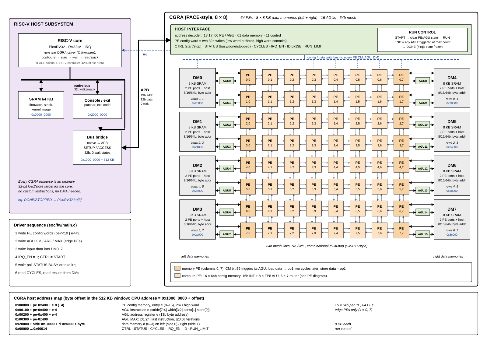

# Re-created PACE CGRA: PE, 8×8 array and RISC-V host (SystemVerilog)

This is a clean-room RTL re-creation of the NUS ECO Lab **PACE** CGRA (Hot Chips 2024). It has three layers:

1. **PE + router** (`rtl/pace_pe.sv`): one processing element of the array.
2. **CGRA** (`rtl/pace_cgra.sv`): an 8×8 mesh of PEs, 4 data memories on the left edge and 4 on the right, 16 address generators (AGUs), and a memory-mapped host port.
3. **RISC-V SoC** (`soc/`): a PicoRV32 RV32IM core runs C firmware that loads a kernel into the CGRA, starts it, waits for it to finish and reads the results back.

The taped-out PACE RTL is not public. Everything here is rebuilt from the lab's public cycle-level model,
[`ecolab-nus/pace-sim`](https://github.com/ecolab-nus/pace-sim) (commit `549d4dd`), and verified against that model's own Rust code.



## How the CGRA talks to the RISC-V core

The CGRA is a **memory-mapped slave**. The RISC-V core is its host and controller. There are no custom instructions and no DMA: every resource is reached with ordinary 32-bit loads and stores into a 512 KB window. The address fields are the ones `pace-sim` uses when it generates the C header (`pace_sys_start.h`) for the lab's IME RISC-V system simulation. In this SoC the window sits at CPU address `0x1000_0000`.

| CGRA offset | Contents |
|---|---|
| `pe<<10 \| e<<3 \| hi<<2` | PE `pe` (= y·8+x) configuration entry `e` (0–15). Write the low word first; writing the high word commits the 64-bit entry |
| `pe<<10 \| 0x100 \| e<<2` | AGU instruction `e` (edge PEs only): `{stride[7:4], width[3:2], const[1], store[0]}` |
| `pe<<10 \| 0x200 \| e<<2` | AGU address register `e` (13-bit byte address) |
| `pe<<10 \| 0x300` | AGU MAX: `[31:24]` index of the last instruction, `[23:0]` iteration count |
| `0x20000 \| side<<16 \| d<<14 \| byte` | Data memory `d` (0–3, top to bottom) on the left (`side` 0) or right (`side` 1) |
| `0x60000` CTRL | Write bit0 = START, bit1 = STOP |
| `0x60004` STATUS | bit0 BUSY, bit1 DONE (write 1 to clear), bit2 STOPPED |
| `0x60008` CYCLES | Cycle count of the current or last run |
| `0x6000C` IRQ_EN | bit0: drive `irq` when DONE or STOPPED |
| `0x60010` ID | `0x13E`, the PACE ID from FLEX's `globals_top.vh` |
| `0x60014` RUN_LIMIT | 0 = run until the AGUs end the kernel; otherwise stop after N cycles (watchdog) |

The driver sequence is in `soc/fw/main.c` and `soc/fw/pace_cgra.h`:

1. Write every PE's configuration words.
2. Write each edge AGU's instructions, address registers and MAX.
3. Write the input data into the DMEMs.
4. Set `IRQ_EN`, then write `CTRL = START`. The controller clears PC, registers and AGU state for one cycle, then runs.
5. The kernel ends when any AGU is triggered after reaching its iteration count. At that point state freezes, `DONE` is set and `irq` is raised (wired to PicoRV32 `irq[3]`). The firmware polls `STATUS`; it could take the interrupt instead.
6. Read `CYCLES` and the results from the DMEMs.

The physical link is an APB-style slave: `psel`, `penable`, `pwrite`, 19-bit `paddr`, 32-bit data, zero wait states. A 30-line bridge (`soc/pace_soc.sv`) connects it to PicoRV32's native bus. The bus protocol PACE silicon actually uses isn't public, so APB is my choice; the address map is the lab's.

## CGRA architecture

| Item | Value |
|---|---|
| Array | 8 × 8 PEs; 64-bit N/S/W/E links between neighbours; single-cycle multi-hop routing; array-edge inputs tied to 0 |
| Memory PEs | Columns 0 and 7 (16 PEs). Config bit 59 triggers the PE's AGU |
| Data memories | 8 × 8 KB: DM0–3 on the left, DM4–7 on the right. DM *d* is shared by rows 2*d* (port A) and 2*d*+1 (port B). Byte-addressed, little-endian, 8/16/64-bit accesses |
| Load timing | A load issued in cycle T is read at the end of T, and op1 takes the data at the end of T+1. The ALU can use it in T+2, matching `pace-sim`'s 2-cycle latency |
| Store | Data = the PE's op1 register; written at the end of the trigger cycle |
| AGUs | 16 (one per edge PE). Each has up to 16 one-byte instructions, a matching 16 × 13-bit address-register file (post-incremented by stride × size in strided mode; fixed in const mode), and a 24-bit iteration limit |
| Configuration storage | 64 PEs × 16 × 64 bits = **8 KB**; AGUs 16 × (16 B instructions + 16 × 13-bit addresses + MAX) |
| Behavioural parts | `pace_dmem.sv` is a byte-array model that zero-fills at start-up, for simulation. Silicon would use dual-port SRAM macros with byte enables, and firmware would write every location a kernel reads |

## CGRA verification

| Check | Result |
|---|---|
| Lab kernel **GEMM** (`pace-sim/tests/gemm`) loaded through the host bus: every PE's pc/op1/op2/res compared each cycle, plus all 8 DMEMs at the end | **21 cycles × 64 PEs + 8 × 8 KB: identical**. `pace-sim`'s own test confirms this kernel's output is a correct matrix product |
| Lab kernel **complex_scalar_8x8** | **25 cycles × 64 PEs + 8 DMEMs: identical** |
| Constrained-random 8×8 kernels: random programs on all 64 PEs (with east/south pass-through chains), random AGU load/store programs on all 16 edge PEs, random DMEM contents, 200 cycles each | **200 kernels, 40,000 array-cycles (each comparing all 64 PEs) plus every final DMEM: 0 mismatches** (Verilator; Icarus spot-checks agree) |
| Mutation test (`scripts/mutate.sh`): 4 deliberately injected RTL bugs (load one cycle early; bypass ignored on mesh outputs; 16-bit stride not scaled; 64-bit store truncated) | **All 4 detected** |
| RISC-V SoC (Verilator): firmware loads GEMM (1,500 bus writes), starts the CGRA, waits for DONE and checksums all 8 DMEMs | **CGRA ran 21 cycles; all 8 checksums equal `pace-sim`'s; `RESULT: PASS`** (1.3 M CPU cycles in total, almost all spent reading 64 KB back over the bus) |

The random-kernel generator (`scripts/gen_array.py`) keeps programs inside what `pace-sim` can execute:
- PCs move in lockstep.
- No undriven wires are read.
- Combinational paths have no cycles.
- No AGU runs off the end of its memory.
- The two ports of a DMEM use disjoint halves.

Run everything with `PACESIM_TESTS=<pace-sim>/tests scripts/run_all.sh`. It needs iverilog, verilator, cargo, python3 and `riscv64-unknown-elf-gcc`.

### Further `pace-sim` findings from the array work

6. **The load-return decision uses the AGU's *next* instruction.** The grid calls `agu.next()` before recording which instruction was issued, so two cycles later the "was this a load, and how wide?" check looks at the *following* AGU instruction. The RTL uses the instruction actually issued. The two only differ when an AGU program mixes types or widths; all of the lab's kernels use single-instruction AGU programs, and the random tests keep one type and width per AGU.
7. **Header address-map bugs in `dump_header.rs`:** the AGU ARF region uses `0x10 << 8` and MAX uses `0x11 << 8` (hex where binary `0b10`/`0b11` was meant), and the AGU-to-PE index mapping (`agu/8`, `agu%8`) puts AGUs 0–7 on row 0. The RTL uses the intended fields: PE index of the owning edge PE, `[9:8]` = 01/10/11.
8. The committed `complex_scalar_8x8/dm*.expected` files don't match `pace-sim`'s own current output (the test doesn't assert them), so they look stale.

---

# The PE (processing element)


## PE contents

| Path | What it is |
|---|---|
| `rtl/pace_pe_pkg.sv` | Opcodes, router source codes, configuration-word field positions |
| `rtl/pace_pe.sv` | PE top: configuration memory, PC/loop controller, decoder, operand and result registers, memory-PE sideband |
| `rtl/pace_router.sv` | 6-source × 7-sink crossbar, 4 input ("parking") registers, bypass muxes |
| `rtl/pace_alu.sv` | 16-bit integer ALU plus 8-lane FP8 SIMD |
| `rtl/pace_fp8_lane.sv` | One FP8 E4M3 add/multiply lane, bit-exact with `pace-sim` |
| `tb/tb_fp8.sv` | Exhaustive FP8 test (all 65,536 operand pairs) |
| `tb/tb_pe.sv` | Trace testbench used for random co-simulation |
| `tb/tb_directed.sv` | Self-checking directed tests (multi-hop, FP8 accumulate, memory PE, parking register) |
| `model/golden/` | Rust driver that runs `pace-sim`'s own `PE` / `FP8` types as the golden reference |
| `scripts/` | Random program generator, regression runner, mini-assembler (`pace_asm.py`), `run_all.sh` |
| `docs/` | ISSCC-style block diagram (SVG) and the script that generates it |
| `rtl/pace_agu.sv`, `rtl/pace_dmem.sv`, `rtl/pace_cgra.sv` | AGU; 8 KB two-port data memory; 8×8 array top with host interface and run control |
| `tb/tb_cgra.sv` | Array testbench acting as the bus host: loads an image, runs, traces all 64 PEs, reads back the DMEMs |
| `scripts/cgra_image.py` | Converts a `pace-sim` kernel folder into host bus writes and a C header for the firmware |
| `scripts/gen_array.py`, `scripts/regress_array.py` | Constrained-random 8×8 kernel generator and co-simulation runner |
| `soc/pace_soc.sv`, `soc/tb_soc.sv`, `soc/fw/` | PicoRV32 SoC, bridge and console; C driver and firmware |
| `soc/third_party/picorv32.v` | PicoRV32 (YosysHQ, ISC licence; commit in `picorv32_VERSION`) |

## Architecture summary

| Item | Value |
|---|---|
| Datapath / link width | 64 bit (one 8 × FP8 vector or one 16-bit scalar, zero-extended) |
| Scalar ALU | 16 bit |
| SIMD | 8 lanes of FP8 E4M3 (bias 7): no subnormals (flushed to zero), round-to-nearest-even, exp = 15 means Inf/NaN |
| **Configuration memory** | **16 entries × 64 bits = 1 Kbit (128 B) per PE**. The 8×8 array holds 8 KB in total. Global address map: PE index in bits [15:10], CM region `00` in bits [9:8], entry in bits [7:4] |
| Execution model | One configuration word per cycle, no stalls; hardware loop via JUMP plus loop-start/loop-end registers |
| Router | 6 sources (N/S/W/E in, ALU_out, ALU_res) to 7 sinks (N/S/W/E out, op1, op2, predicate). 3-bit select per sink. N/S/W/E outputs are **combinational**, so one value can cross several PEs in one cycle (multi-hop) |
| Router storage | 4 × 64-bit input registers, each with its own write-enable and bypass-select bit |
| PE state | op1, op2 and res (64 bit each); PC (4 bit); loop start and end (5 bit each); prev-JUMP flag |
| Memory PE (`MEM_PE=1`, columns 0 and 7) | `agu_trigger` driven from cfg bit 59; `st_data` = op1; returned load data overrides op1 |

### Configuration word (64 bit)

```
 63  62  61  60  59  58..51  50........35  34..30  29..26  25  24..21  20..18 17..15 14..12 11..9 8..6 5..3 2..0
 P   I   F   B   A   unused     imm16      opcode   we     U   bypass   pred   op2    op1    N    W    S    E
                            JUMP: [49:45]=dst [44:40]=loop_end [39:35]=loop_start
```

- **I**: immediate valid. Scalar op2 is replaced by imm16.
- **U**: write the ALU result into `res`.
- **A**: AGU trigger (memory PEs only).
- **we / bypass**: one bit per direction, ordered `{N,S,W,E}` (bit 3 = N … bit 0 = E).
- **Switch codes**: 0 = E_in, 1 = S_in, 2 = W_in, 3 = N_in, 4 = ALU_out (combinational), 5 = ALU_res (registered), 7 = open (6 is reserved and treated as open). An open op1/op2 keeps its old value; an open mesh output drives 0.
- **P / F / B** (bits 63, 61, 60) are reserved. `pace-sim` does not model them, so they are ignored.

### Supported instructions

Scalar ops compute `a = op1[15:0]` and `b = I ? imm16 : op2[15:0]`. The result is zero-extended to 64 bits unless noted.

| Opcode | Mnemonic | Semantics |
|---:|---|---|
| 0 | NOP | No ALU result. Must not route ALU_out or set U |
| 1 | ADD | a + b (mod 2¹⁶) |
| 2 | SUB | a − b (mod 2¹⁶) |
| 3 | MULT | (a × b)[15:0] |
| 5 | DIV | a / b, unsigned. **b = 0 gives 0xFFFF** (this RTL's definition; `pace-sim` panics) |
| 6 | VADD | 8 × FP8: op1 + op2 per lane (the immediate is ignored) |
| 7 | VMUL | 8 × FP8: op1 × op2 per lane |
| 8 | LS | a << b[3:0] |
| 9 | RS | a >> b[3:0] (logical) |
| 10 | ASR | a >>> b[3:0]. **Result is sign-extended to 64 bits** |
| 11 / 12 / 13 | AND / OR / XOR | bitwise |
| 16 | SEL | if a[15] then a, else if b[15] then b, else 0 |
| 17 | CMERGE | I ? imm16 : op1 (the full 64 bits of op1) |
| 18 | CMP | a == b (1-bit result) |
| 19 | CLT | a ≤ b, **unsigned** (as `pace-sim` executes it; its source comment says "signed") |
| 21 | CGT | a ≥ b, unsigned |
| 30 | JUMP | Control op: no ALU result, does not write res. Sets loop_start and loop_end. On the first cycle of a JUMP, pc = dst; on later consecutive JUMP cycles the normal loop rule applies |

**Next-PC rule:**
- JUMP when the previous op was not a JUMP: `pc = dst`.
- Otherwise, if `pc ≥ loop_end` or `pc < loop_start`: `pc = loop_start`.
- Otherwise: `pc = pc + 1`.
- At reset: `loop_start = 0`, `loop_end = 15`.

**Defined in the ISA but not implemented** (they raise `dbg_illegal` and produce 0):
- SEXT (4), BR (20), MOVCL (23), MOVC (31). `pace-sim` does not implement these either.
- LOAD/STORE variants (14, 15, 24, 26, 27, 29). These are deprecated: on PACE the AGU performs memory accesses, triggered by bit 59.

### Cycle semantics

Within a cycle, `cfg = CM[pc]`; `alu_out = ALU(op1, op2)`; and the router outputs are combinational. At the clock edge:
- `res` takes `alu_out` if U is set.
- `op1` and `op2` take the router's selected value (unless their select is open).
- The input registers latch their wires where `we` is set.
- `pc` advances.

`pace-sim` updates its registers in sequence (`res` → input registers → op1/op2). As a result, in `pace-sim`, op1/op2 see **this cycle's** new values of `res` and of any input register written in the same cycle. The RTL reproduces this with write-through forwarding muxes (parameter `PACESIM_FWD=1`, the default). Setting `PACESIM_FWD=0` gives plain flop semantics instead; that variant is lint-checked only. The mesh outputs always see the old register values, in both modes.

## Verification

Run `scripts/run_all.sh`. It needs Icarus Verilog 12+, Verilator 5+, cargo and python3.

| Check | Result |
|---|---|
| Verilator `-Wall` lint, both parameter sets | Clean (unused-bit warnings only, for the reserved fields) |
| FP8 lane vs `pace-sim` `FP8` type, all 65,536 (a,b) pairs, VADD and VMUL | **0 mismatches** |
| Random co-simulation vs `pace-sim` `PE`: 1,000 programs × 500 cycles, Icarus | **500,000 cycles, 0 mismatches** |
| Same flow on Verilator: 300 programs × 500 cycles | **150,000 cycles, 0 mismatches** |
| Directed tests: 1×3 array multi-hop (PE0→PE1→PE2 in one cycle), FP8 accumulate (saturates at 16.0 by round-to-nearest-even), memory-PE load/store/trigger, parking register | **PASS** |

In each random-test cycle, the trace compares:
- pc
- alu_out
- all four mesh outputs
- op1, op2 and res
- all four input registers
- loop start and loop end

Every implemented opcode executes more than 20k times across the 1,000-program run.

Each random program is 16 configuration words. Its fields, the reserved bits and the input data are random. The only constraints exclude cases where `pace-sim` itself panics or disagrees with the hardware structure:
- No ALU_out routing or U bit on NOP/JUMP.
- No predicate routing (`todo!()` in `pace-sim`).
- No S/W/N outputs drawn from a bypassed direction (see the first finding below).

### Findings about `pace-sim` uncovered while doing this

1. **Bypass is honoured only on `east_out`.** `pace-sim` uses the input register for bypassed directions only on the E output; S, W and N outputs always take the wire. The FLEX RTL (`xbar_bypass.sv`) applies bypass uniformly to every output, and so does this RTL. This looks like a `pace-sim` bug.
2. **Register update order gives write-through semantics** (described above). It's unclear whether silicon does the same; it's exposed here as `PACESIM_FWD`.
3. **CLT/CGT are unsigned** in the code, but the source comment says signed.
4. **ASR sign-extends to 64 bits**, while every other scalar op zero-extends.
5. **DIV by zero panics**, and so does **NOP with U=1**.
