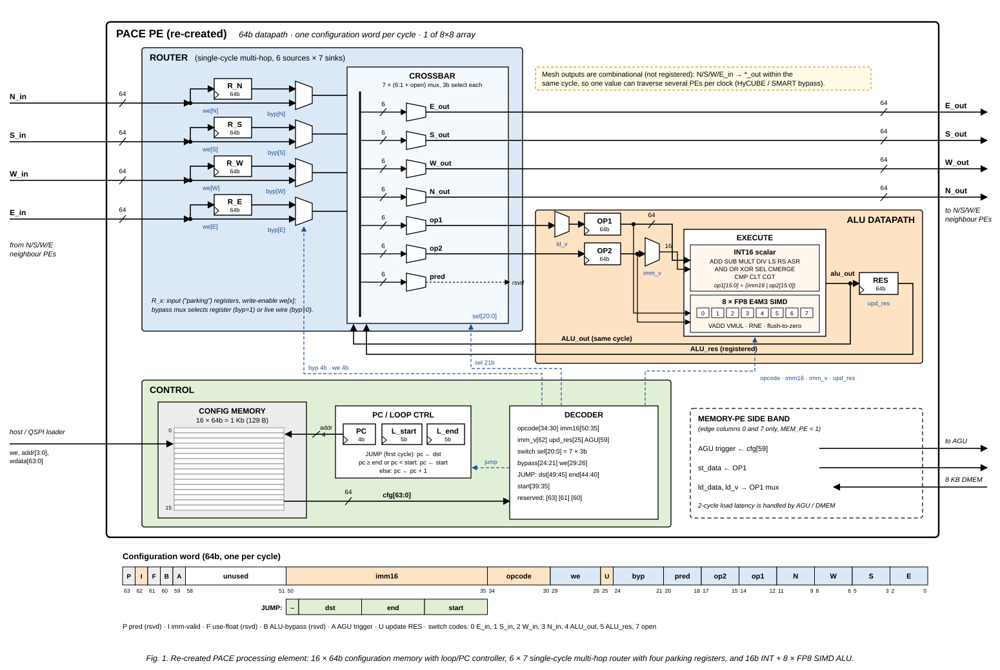

# Re-created PACE CGRA PE + router (SystemVerilog)

This is a clean-room RTL re-creation of one **processing element (PE)** of the
NUS ECO Lab **PACE** CGRA, including its **router**. PACE is a HyCUBE-style
8×8 CGRA presented at Hot Chips 2024.

The taped-out PACE RTL is not public. This design is rebuilt from the lab's
public cycle-level model,
[`ecolab-nus/pace-sim`](https://github.com/ecolab-nus/pace-sim) (commit
`549d4dd`). Router structure was cross-checked against the public FLEX RTL
(`ecolab-nus/FLEX/Microarchitecture/rtl`). The design is verified
cycle-by-cycle against `pace-sim` itself: the golden model *is* the lab's
code, not a re-implementation.



## Contents

| Path | What it is |
|---|---|
| `rtl/pace_pe_pkg.sv` | Opcodes, router source codes, configuration-word field positions |
| `rtl/pace_pe.sv` | PE top: configuration memory, PC/loop controller, decoder, operand and result registers, memory-PE sideband |
| `rtl/pace_router.sv` | 6-source × 7-sink crossbar, 4 input ("parking") registers, bypass muxes |
| `rtl/pace_alu.sv` | 16-bit integer ALU plus 8-lane FP8 SIMD |
| `rtl/pace_fp8_lane.sv` | One FP8 E4M3 add/multiply lane, bit-exact with `pace-sim` |
| `tb/tb_fp8.sv` | Exhaustive FP8 test (all 65,536 operand pairs) |
| `tb/tb_pe.sv` | Trace testbench used for random co-simulation |
| `tb/tb_directed.sv` | Self-checking directed tests (multi-hop, FP8 accumulate, memory PE, parking register) |
| `model/golden/` | Rust driver that runs `pace-sim`'s own `PE` / `FP8` types as the golden reference |
| `scripts/` | Random program generator, regression runner, mini-assembler (`pace_asm.py`), `run_all.sh` |
| `docs/` | ISSCC-style block diagram (SVG) and the script that generates it |

## Architecture summary

| Item | Value |
|---|---|
| Datapath / link width | 64 bit (one 8 × FP8 vector or one 16-bit scalar, zero-extended) |
| Scalar ALU | 16 bit |
| SIMD | 8 lanes of FP8 E4M3 (bias 7): no subnormals (flushed to zero), round-to-nearest-even, exp = 15 means Inf/NaN |
| **Configuration memory** | **16 entries × 64 bits = 1 Kbit (128 B) per PE**. The 8×8 array holds 8 KB in total. Global address map: PE index in bits [15:10], CM region `00` in bits [9:8], entry in bits [7:4] |
| Execution model | One configuration word per cycle, no stalls; hardware loop via JUMP plus loop-start/loop-end registers |
| Router | 6 sources (N/S/W/E in, ALU_out, ALU_res) to 7 sinks (N/S/W/E out, op1, op2, predicate). 3-bit select per sink. N/S/W/E outputs are **combinational**, so one value can cross several PEs in one cycle (multi-hop) |
| Router storage | 4 × 64-bit input registers, each with its own write-enable and bypass-select bit |
| PE state | op1, op2 and res (64 bit each); PC (4 bit); loop start and end (5 bit each); prev-JUMP flag |
| Memory PE (`MEM_PE=1`, columns 0 and 7) | `agu_trigger` driven from cfg bit 59; `st_data` = op1; returned load data overrides op1 |

### Configuration word (64 bit)

```
 63  62  61  60  59  58..51  50........35  34..30  29..26  25  24..21  20..18 17..15 14..12 11..9 8..6 5..3 2..0
 P   I   F   B   A   unused     imm16      opcode   we     U   bypass   pred   op2    op1    N    W    S    E
                            JUMP: [49:45]=dst [44:40]=loop_end [39:35]=loop_start
```

- **I**: immediate valid. Scalar op2 is replaced by imm16.
- **U**: write the ALU result into `res`.
- **A**: AGU trigger (memory PEs only).
- **we / bypass**: one bit per direction, ordered `{N,S,W,E}` (bit 3 = N … bit 0 = E).
- **Switch codes**: 0 = E_in, 1 = S_in, 2 = W_in, 3 = N_in, 4 = ALU_out (combinational), 5 = ALU_res (registered), 7 = open (6 is reserved and treated as open). An open op1/op2 keeps its old value; an open mesh output drives 0.
- **P / F / B** (bits 63, 61, 60) are reserved. `pace-sim` does not model them, so they are ignored.

### Supported instructions

Scalar ops compute `a = op1[15:0]` and `b = I ? imm16 : op2[15:0]`. The result is zero-extended to 64 bits unless noted.

| Opcode | Mnemonic | Semantics |
|---:|---|---|
| 0 | NOP | No ALU result. Must not route ALU_out or set U |
| 1 | ADD | a + b (mod 2¹⁶) |
| 2 | SUB | a − b (mod 2¹⁶) |
| 3 | MULT | (a × b)[15:0] |
| 5 | DIV | a / b, unsigned. **b = 0 gives 0xFFFF** (this RTL's definition; `pace-sim` panics) |
| 6 | VADD | 8 × FP8: op1 + op2 per lane (the immediate is ignored) |
| 7 | VMUL | 8 × FP8: op1 × op2 per lane |
| 8 | LS | a << b[3:0] |
| 9 | RS | a >> b[3:0] (logical) |
| 10 | ASR | a >>> b[3:0]. **Result is sign-extended to 64 bits** |
| 11 / 12 / 13 | AND / OR / XOR | bitwise |
| 16 | SEL | if a[15] then a, else if b[15] then b, else 0 |
| 17 | CMERGE | I ? imm16 : op1 (the full 64 bits of op1) |
| 18 | CMP | a == b (1-bit result) |
| 19 | CLT | a ≤ b, **unsigned** (as `pace-sim` executes it; its source comment says "signed") |
| 21 | CGT | a ≥ b, unsigned |
| 30 | JUMP | Control op: no ALU result, does not write res. Sets loop_start and loop_end. On the first cycle of a JUMP, pc = dst; on later consecutive JUMP cycles the normal loop rule applies |

**Next-PC rule:**
- JUMP when the previous op was not a JUMP: `pc = dst`.
- Otherwise, if `pc ≥ loop_end` or `pc < loop_start`: `pc = loop_start`.
- Otherwise: `pc = pc + 1`.
- At reset: `loop_start = 0`, `loop_end = 15`.

**Defined in the ISA but not implemented** (they raise `dbg_illegal` and produce 0):
- SEXT (4), BR (20), MOVCL (23), MOVC (31). `pace-sim` does not implement these either.
- LOAD/STORE variants (14, 15, 24, 26, 27, 29). These are deprecated: on PACE the AGU performs memory accesses, triggered by bit 59.

### Cycle semantics

Within a cycle, `cfg = CM[pc]`; `alu_out = ALU(op1, op2)`; and the router outputs are combinational. At the clock edge:
- `res` takes `alu_out` if U is set.
- `op1` and `op2` take the router's selected value (unless their select is open).
- The input registers latch their wires where `we` is set.
- `pc` advances.

`pace-sim` updates its registers in sequence (`res` → input registers → op1/op2). As a result, in `pace-sim`, op1/op2 see **this cycle's** new values of `res` and of any input register written in the same cycle. The RTL reproduces this with write-through forwarding muxes (parameter `PACESIM_FWD=1`, the default). Setting `PACESIM_FWD=0` gives plain flop semantics instead; that variant is lint-checked only. The mesh outputs always see the old register values, in both modes.

## Verification

Run `scripts/run_all.sh`. It needs Icarus Verilog 12+, Verilator 5+, cargo and python3.

| Check | Result |
|---|---|
| Verilator `-Wall` lint, both parameter sets | Clean (unused-bit warnings only, for the reserved fields) |
| FP8 lane vs `pace-sim` `FP8` type, all 65,536 (a,b) pairs, VADD and VMUL | **0 mismatches** |
| Random co-simulation vs `pace-sim` `PE`: 1,000 programs × 500 cycles, Icarus | **500,000 cycles, 0 mismatches** |
| Same flow on Verilator: 300 programs × 500 cycles | **150,000 cycles, 0 mismatches** |
| Directed tests: 1×3 array multi-hop (PE0→PE1→PE2 in one cycle), FP8 accumulate (saturates at 16.0 by round-to-nearest-even), memory-PE load/store/trigger, parking register | **PASS** |

In each random-test cycle, the trace compares:
- pc
- alu_out
- all four mesh outputs
- op1, op2 and res
- all four input registers
- loop start and loop end

Every implemented opcode executes more than 20k times across the 1,000-program run.

Each random program is 16 configuration words. Its fields, the reserved bits and the input data are random. The only constraints exclude cases where `pace-sim` itself panics or disagrees with the hardware structure:
- No ALU_out routing or U bit on NOP/JUMP.
- No predicate routing (`todo!()` in `pace-sim`).
- No S/W/N outputs drawn from a bypassed direction (see the first finding below).

### Findings about `pace-sim` uncovered while doing this

1. **Bypass is honoured only on `east_out`.** `pace-sim` uses the input register for bypassed directions only on the E output; S, W and N outputs always take the wire. The FLEX RTL (`xbar_bypass.sv`) applies bypass uniformly to every output, and so does this RTL. This looks like a `pace-sim` bug.
2. **Register update order gives write-through semantics** (described above). It's unclear whether silicon does the same; it's exposed here as `PACESIM_FWD`.
3. **CLT/CGT are unsigned** in the code, but the source comment says signed.
4. **ASR sign-extends to 64 bits**, while every other scalar op zero-extends.
5. **DIV by zero panics**, and so does **NOP with U=1**.
